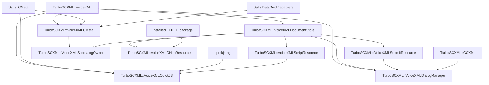
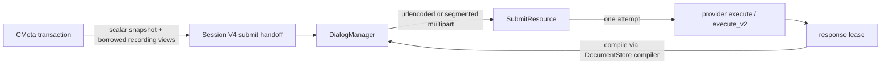

# VoiceXML architecture

## Status

TurboSCXML provides an **incubating, bounded VoiceXML 2.0/2.1 runtime**. It is
not a claim of full VoiceXML conformance. The supported surface is defined by
executable tests, explicit profile contracts, installed target dependencies,
and the support/conformance work tracked by issue #51.

The executable support truth is maintained in
[VoiceXML support and conformance evidence matrix](voicexml-support-matrix.md).
The matrix links every supported/partial surface to concrete positive and
negative witnesses and records provenance rules.

The architecture has moved beyond the original non-media MVP. The canonical
runtime now includes:

- immutable base VoiceXML Program/Session execution;
- typed CMeta executable content and FIA;
- optional QuickJS script/data execution;
- prompt/media, grammar/collect, menu/initial, subdialog, record, transfer;
- DocumentStore, ScriptResource and one-attempt SubmitResource;
- external navigation and typed submit response continuation;
- CCXML DialogManager integration;
- optional CHTTP adapters that remain outside the VoiceXML core.

Unsupported language or provider capabilities fail explicitly. TurboSCXML does
not silently approximate DOM/ECMAScript semantics, provider behavior, retry
semantics, or ownership.

## Core invariants

1. **Program is immutable.** Compilers retain all request/control metadata in
   Program-owned storage. Runtime state never mutates the Program.
2. **Session is single-owner and synchronous.** Async providers publish through
   bounded generation-safe mailboxes/tickets; serialized Session progress owns
   state mutation.
3. **Profiles are explicit.** Literal, CMeta, and QuickJS behavior do not
   silently reinterpret each other.
4. **Providers are capability-gated.** Missing capability is rejected before
   provider admission or mapped to the exact runtime Event required by the
   implemented profile.
5. **Resource ownership is explicit.** Every provider-owned lease has one
   owner and one exact settlement path.
6. **POST is one-attempt.** SubmitResource never retries a request after
   provider admission; `POSSIBLY_PROCESSED` is terminal.
7. **No transport implementation enters the core.** CHTTP is an optional
   installed adapter package boundary.
8. **All retained/scratch data is bounded.** URI, source, expression, prompt,
   snapshot, recording, multipart and result storage have explicit limits.

## Installed target graph



Important dependency rules:

- `TurboSCXML::VoiceXML` does not link CMeta, DataBind, QuickJS or CHTTP.
- `VoiceXMLCMeta` owns typed/DataBind integration.
- `VoiceXMLQuickJS` owns QuickJS and the private transactional CMeta bridge.
- `VoiceXMLDialogManager` does not link CMeta or QuickJS.
- CHTTP adapters consume the installed CHTTP package; TurboSCXML does not
  duplicate CHTTP's private llhttp/TLS/DNS dependency graph.

## Compiler and Program model

### Base VoiceXML

The base compiler owns profile-neutral immutable structure and handoffs:

- document/form/block layout;
- literal exit/goto/submit/script descriptors;
- profile-neutral data request metadata when an explicit profile feature
  enables it;
- navigation, submit and script control-transfer records.

The base public compiler remains fail-closed for profile-specific surfaces it
cannot execute.

### CMeta profile

`TurboSCXML::VoiceXMLCMeta` adds a typed compiled layer over the same
VoiceXML Program lifecycle.

It owns:

- document/form/block lexical CMeta scopes;
- `var`, `assign`, `clear`, guards and typed namelists;
- transactional staged/committed root and local scope state;
- Event handlers and retry counters;
- fields, menus and initial mixed-initiative collection;
- prompt/media rows, marks and bounded prompt `foreach`;
- typed external `data` through DataBind;
- subdialog, record and transfer form items;
- typed submit scalar/recording projection.

DataBind owns typed format decoding. CMeta Session ownership does not extend
into transport providers.

### QuickJS profile

`TurboSCXML::VoiceXMLQuickJS` is an opt-in ECMAScript surface built on the
private hardened QuickJS sandbox.

It owns:

- compile-time validation for supported dynamic expressions;
- fresh hardened QuickJS contexts;
- bounded heap/stack/result storage and monotonic wall-clock deadline;
- external `script@src` / `script@srcexpr` acquisition and execution;
- transactional import/export through the private CMeta bridge;
- no-DOM `<data>` request side effects.

The supported safety contract does **not** claim a deterministic QuickJS
bytecode-instruction quota when the pinned engine ABI cannot provide one.

QuickJS `<data>` deliberately discards response bytes. It does not create a
DOM facade or persistent arbitrary JS object graph.
One request evaluates its URI expression and namelist in the same context.
The next request or `script@srcexpr` activation starts a fresh context, including
in target-only mode without a CMeta root. Only committed typed state is imported
when a root is configured; temporary JavaScript globals are not carried forward.

## Session execution and FIA

The CMeta Session is the main typed FIA owner:

```text
document initializers
  -> enter form
  -> form initializers / initial
  -> select directed item
  -> prompt / collect / provider handoff
  -> process completion
  -> local filled / form filled
  -> reselect or terminal/control transfer
```

Generation-safe provider contracts ensure stale completion cannot mutate a
newer activation.

Implemented directed/control surfaces include:

- field collect and scoped noinput/nomatch recovery;
- menu/choice and generated/explicit grammar paths;
- initial mixed-initiative collection;
- subdialog child lifecycle;
- record provider + Session-owned recording result lease;
- transfer provider + exact result/Event mapping;
- exit/return/disconnect terminal snapshots.

Async item kinds have explicit prepare/commit/discard/cancel/quiesce
boundaries. Completion ingress distinguishes accepted, stale, incompatible,
full and closed states where applicable.

## Prompt and media boundary

TurboSCXML does not implement TTS/ASR/media transport internally.

The prompt/media provider boundary receives immutable/bounded projections for:

- text;
- SSML;
- audio with fallback;
- marks;
- prompt `foreach` expansion;
- generation-owned dynamic mark names.

Provider elapsed timing may be reported through the supported observation
contract. TurboSCXML does not invent playback time when the provider did not
report it.

Barge-in, completion and cancellation are generation-affine and settle one
active provider generation exactly once.

## Grammar and collect boundary

Grammar/recognition is an external capability-gated provider surface.

The current typed profile supports the implemented static and dynamic grammar
forms, including VoiceXML 2.1 `grammar@srcexpr`, menu exact/approximate speech
policy, initial multi-slot completion and recorded-utterance result ownership.

Dynamic expressions are compiled/validated once and evaluated at the specified
activation phase. Provider requests receive bounded Session-owned or
Program-owned views only.

## Resource boundaries

### VoiceXMLDocumentStore

DocumentStore owns:

- URI resolution;
- bounded document acquisition;
- source copying/cache lifetime;
- generation-safe cache borrows;
- one configured compiler adapter.

`vxml_document_store_compile_source()` uses the same compiler for borrowed
submit-response bytes without fetching or caching them. This keeps one compiler
owner for initial/navigation/submit-response Programs.

### VoiceXMLScriptResource

ScriptResource is the acquisition boundary for external QuickJS source. A
successful lease is closed exactly once when its consumer finishes using the
borrowed source bytes.

### VoiceXMLSubmitResource

SubmitResource owns transport-neutral request encoding and the one-attempt
provider call.

Supported generic handoffs include:

- V1 literal zero-field urlencoded submit;
- V2 ordered scalar fields;
- V3 timeout/fetchaudio policy;
- V4 ordered scalar + explicit recording multipart views.

Multipart uses one global ordered part-ref array so interleaved scalar and
recording namelist order is preserved. Recording payload bytes are borrowed
from the Session-owned lease; SubmitResource neither copies nor releases that
lease.



Timeout/fetchaudio policy is represented in the generic Session handoff.
DialogManager owns URI resolution, fetch-audio bracketing and provider
execution; CMeta only projects policy.

## DialogManager and CCXML

`TurboSCXML::VoiceXMLDialogManager` is the serialized CCXML bridge.

It owns dialog rows, document borrows, current Session, navigation/submit hop
budget, response Program lifetime and Event publication.

Store-backed managers use two profile-neutral boundaries:

1. DocumentStore's configured compiler;
2. optional `vxml_session_factory_v1` for the matching runtime profile.

This means an application can pair a CMeta or QuickJS compiler/runtime without
DialogManager linking either target or switching on profile names.

Initial documents, external navigation targets and submit-response Programs use
the same compiler/runtime pair.

The factory's optional `execute_script`/`max_script_steps` tail also lets
`run_ready()` consume synchronous `SCRIPTING` handoffs. Its per-dialog budget
survives navigation and submit-response Session replacement, independently of
the navigation-hop budget. The callback borrows the current document URI and
Session, and settles script resources before returning. Event backpressure
retries publication without repeating execution. Historical factory prefixes
retain manual handoff behavior; see the [script progress contract](voicexml-dialog-manager.md#profile-neutral-script-progress).

The factory's optional `run_ready`/`quiesce` pair drives asynchronous profiles
without adding a CMeta dependency to the manager. CMeta provides
`vxml_session_cmeta_run_ready` to admit and settle the current prompt/collect,
subdialog, record or transfer operation. Running rows share a round-robin work
budget; asynchronous handoffs keep one dialog identity and one `dialog.started`.
Before Session replacement or destruction, the factory barrier stops and joins
its completion producers, then Session close settles provider resources. See
the [asynchronous progress contract](voicexml-dialog-manager.md#asynchronous-profile-progress).

## Ownership table

| Resource | Owner | Borrowed by | Settlement |
| --- | --- | --- | --- |
| immutable Program | compiler caller / DocumentStore entry | Session | destroy after Session/borrow ends |
| document source lease | document provider | DocumentStore acquire | close exactly once after copy |
| external script lease | script provider | QuickJS execution | close exactly once |
| data resource lease | data provider | CMeta/QuickJS request | close exactly once |
| prompt/collect ticket | media/recognition provider | Session generation | commit/discard/cancel/quiesce |
| record result lease | CMeta Session | submit multipart view, query APIs | Session release only |
| transfer/subdialog completion | provider mailbox | Session generation | quiesce/cancel by lifecycle |
| submit response lease | submit provider | DialogManager | close exactly once after compile/decision |

No generic transport component releases a recording lease.

## VoiceXML 2.1 delivered surface

The tracked VoiceXML 2.1 delivery includes executable positive/negative tests
for:

- dynamic grammar `srcexpr`;
- external QuickJS `script@srcexpr`;
- `mark@nameexpr` and last-result mark metadata;
- dynamic/static `data` request semantics;
- bounded prompt `foreach`;
- static `property@fetchaudio` inheritance;
- `transfer@type`;
- recorded-utterance metadata and recording shadows;
- typed CMeta submit with urlencoded and explicit-recording multipart paths.

VoiceXML 2.0 base behavior remains separately tested; 2.1-only constructs are
version-gated rather than approximated in 2.0 documents.

## Failure model

TurboSCXML uses fail-fast semantics:

- malformed descriptors: invalid structure/contract;
- missing provider capability: unsupported before callback or exact Event;
- stale generation: rejected without mutation;
- full bounded ingress: explicit FULL result;
- closed Session/provider ingress: explicit CLOSED result;
- allocation/size bound: deterministic limit/allocation failure;
- provider may-have-processed POST: terminal `POSSIBLY_PROCESSED`;
- unsupported CMeta/QuickJS value shape: reject before provider admission.

There is no implicit fallback from a newer provider contract to an older one
when doing so would discard required semantics.

## Independent Host Active Object

The Component integration fixture uses a CFlow Machine Actor for independent
Host control work. It borrows a DialogManager and its Component generation
scope; it does not wrap a language Session in another Statechart. VoiceXML and
CCXML retain their existing interpreter, controller and effect-ticket owners.
This is a tested composition, not an installed VoiceXML Actor facade.

The Host uses one owner-affine CFlow Executor and a Scheduler bound to that
same executor. The owner drives progress, actions, subscriber callbacks and
stop/destroy operations. Producers send small typed control values through
retained Actor refs. Successful admission copies the value into a fixed-capacity
mailbox; FULL rejects without changing an already accepted message. The control
value is a fixture-local generation discriminator, not a copied Component scope
or a general-purpose generation handle.

The Actor action checks the borrowed scope generation and control value before
calling `vxml_dialog_manager_run_ready`. Typed mailbox admission does not itself
validate domain generation identity: a foreign generation control can be
accepted into the mailbox and then fail at the Host action boundary. That
failure preserves its first error, cancels queued controls and reports one
`on_error`, without opening a document. Normal stop before owner progress cancels
all queued controls and reports one `on_done` without advancing the dialog.

Actor stop is distinct from DialogManager close. The manager still owns any
committed CCXML dialog-start ticket. Teardown therefore settles and destroys the
Actor while its callback context remains live, releases producer refs, closes
the manager, and only then releases its Component scope and drains the generation.
An observed Actor terminal state alone is not callback quiescence; drive the owner
through terminal callback return before waiting or releasing borrowed objects.
Producer refs reject after stop/failure and become STALE after Actor destruction.

[`voicexml_component_dialog_test.c`](../../tests/voicexml_component_dialog_test.c)
covers successful bounded delivery, FULL, copied payloads, queued-control stop,
foreign-generation failure, retained-ref invalidation, and the existing real DSO
generation-publication overlap. The latter gates the Host action before DSO
document admission; it does not pause inside the DSO resource callback. These
owner-affine tests do not qualify foreign-thread stop with a worker Scheduler or
general concurrent DSO unload. Delivery and broader qualification remain tracked
in [issue #303](https://github.com/qigao/turbo-scxml/issues/303); replacing the
Session execution owner remains a separate investigation in
[issue #304](https://github.com/qigao/turbo-scxml/issues/304).

The same suite's "CCXML controllers across Component publication" group runs
compiled CCXML Programs through real `ccxml_session_dispatch` calls. A bounded
test datamodel stages returned dialog IDs in owned storage and publishes them
only on ticket commit. The old controller prepares before publication, then
starts the retained Program after publication without refetching. A second
prepare uses a fresh ID and terminates without refetching. Closing the controller
returns BUSY while upstream is non-quiescent and rejects further dispatch;
successful destruction still leaves generation drain blocked until its outer
Component scope is released. After old DSO unload, the new controller executes
direct start with the new DSO. Event IDs, resource open/close markers and one
upstream close per manager witness the boundaries. This covers serialized
controller/resource composition; it does not add a production datamodel or
qualify concurrent dispatch into one Session.

Two rejection witnesses in that group exercise a later telephony action failure
after gN+1 publication. Failed prepared start and terminate both restore the old
prepared row, leave its Program and ID unchanged, publish no new Event, and allow
a subsequent start without refetching. Failed replacement prepare discards its
staged ID and reserved row while preserving the previous committed ID; the one
dialog slot is then reusable through the original generation. Generation drain
remains BUSY until the owning scope is released in teardown.

The group also backpressures `dialog.exit` after accepting `dialog.started`.
An independent gN+1 dialog completes while gN retains exactly one pending
terminal Event. Retrying gN publishes only that exit, with the original ID and
without another document open. A separate close path clears the blocked row,
rejects later progress/dispatch, and closes upstream once across BUSY retries;
after upstream quiescence, controller/manager destruction and scope release
permit the old generation to drain. Closing does not fabricate delivery of the
previously rejected exit Event.

With the Component-enabled graph and matching SDK roots, the focused Windows
VS developer-environment commands are:

```powershell
cmake --preset win-release-user -DTURBOSCXML_ENABLE_COMPONENT=ON
cmake --build --preset win-release-user --target voicexml_component_dialog_test voicexml_dialog_manager_test voicexml_session_test
ctest --preset win-release-user --output-on-failure -R "^voicexml_(component_dialog|dialog_manager|session)_test$"
```

## Platform and package qualification

Native SDK qualification is the release standard:

- Windows x64;
- Linux x64 Release;
- Linux ASan + UBSan;
- macOS;
- Android arm64-v8a;
- installed C and C++ consumers;
- feature-OFF / Plugin-disabled package checks where applicable.

Dependencies from GitHub packages are consumed as released/latest package
artifacts; consumer CMake must not require pinned exact package versions.

## Conformance and security

Security and sensitive-data handling is defined by
[VoiceXML security and sensitive-data policy](voicexml-security-policy.md).
The default contract redacts QuickJS exception payloads and provider-controlled
prepare-error text from TurboSCXML-owned diagnostics.

TurboSCXML remains an incubating profile. The
[VoiceXML support and conformance evidence matrix](voicexml-support-matrix.md)
is the current evidence surface. Issue #51 owns the remaining hardening work:

- upkeep/extension of the VoiceXML-specific evidence matrix and provenance;
- parser/runtime fuzzing and minimized regressions;
- supported option-matrix qualification;
- URI/script/recording/logging security policy;
- default redaction of sensitive prompt/input/recording data.

Do not infer VoiceXML conformance from the SCXML W3C manifest; they are
different language surfaces.

## QuickJS and FIA composition work in progress

The combined profile is **internal and not yet qualified or installed**. The
existing public CMeta and QuickJS support claims are unchanged. Completion
requires executable JavaScript and script resource handoffs in the same FIA,
media transaction qualification, CCXML/DialogManager integration, and installed
C/C++ consumers; an expression-only bridge does not complete this work.

The chosen direction reuses the CMeta compiler, lexical schemas, Session and
FIA transaction owner. A private expression backend table is copied into the
immutable Program; each expression owns its source and copied limits. The
compile-only configuration pointer is not retained. Each evaluation creates a
fresh hardened QuickJS context and projects the active typed bindings. There
is no shared interpreter, registry, second Session or parallel authoritative
application state. CMeta-only never links QuickJS; the internal combined
library is built only when both features are enabled.

Unqualified names resolve from the nearest declared lexical slot to the
application root. An undeclared slot does not hide an outer name; a declared
unbound slot does. JavaScript writes are converted into independently owned typed scratch
and published only after the expression result and every conversion succeed.
Publication to staged state remains subject to the enclosing FIA rollback.
Conversion errors, exceptions, allocation failures and deadline expiry discard
scratch. Result strings are copied into Session expression scratch before the
QuickJS context is destroyed. The bridge reuses CMeta descriptors and lifecycle
admission; it does not define another reflection or value ownership system.

The evaluation runs exclusively on the Session owner. Source, heap, stack,
deadline, visible properties, conversion depth, collection size, string size
and native snapshot storage have explicit limits. The engine deadline remains
active during conversion because JavaScript getters can execute there. Provider
callbacks and completion ingress keep their existing ownership and generation
contracts; the backend adds no threads or providers.

#### Qualified typed scope access

The private JavaScript evaluator now projects `application`, `document`, and
`dialog` objects from the existing CMeta owners. Application properties refer to
host-root slots, document properties to declared document slots, and dialog
properties to declared form slots. Current-form field and subdialog result
properties additionally alias their existing root-backed result storage. That
projection does not relocate those results or change the CMeta location lookup
contract in the public CMeta-only profile. Anonymous executable variables remain unqualified. An unavailable
scope has no predefined object.

Every typed slot has one evaluation-local JavaScript cell. Nonconfigurable
accessors forward qualified and visible unqualified reads/writes to that cell,
including structured values; assigning through one name is immediately visible
through the other. Hidden outer slots have their own cells and remain reachable
through their scope. Export converts each cell once into independent native
scratch before publishing any of them. Existing outer FIA rollback still owns
the final commit. This avoids duplicate imports with divergent writes or two
cleanup obligations for one CMeta slot. All declared slots, including hidden
ones, count toward property and native snapshot bounds. Engine heap limits also
cover namespace objects, accessor functions and cells.

Predefined names follow their owner's precedence: a closer declared variable
can hide a scope name, while a document/form predefined name hides a host-root
field with that name. Each scope contains its own predefined name unless a
typed declaration at that level hides it. Namespace objects have null,
nonmutable prototypes and cannot acquire undeclared properties; predefined
references cannot be replaced. They and their accessor closures live only in
the current hardened context and retain no native pointers or provider leases.

This is the **existing typed-profile mapping**, not the complete standard scope
model in [VoiceXML 2.0 section 5.1.2](https://www.w3.org/TR/voicexml20/#dml5.1.2).
Host-root application storage remains distinct from document declarations;
application-root document aliasing, read-only session variables and persistent
JavaScript declarations remain pending.

The private combined backend also opts into qualified XML locations, including
`assign@name`, `clear@namelist`, and exit snapshots. The compiler retains the
original qualified name and resolves it into the existing native location
candidates; runtime state, declared bits and ownership remain in the CMeta
Session. Namespace lookup selects only the named owner's declarations or the
current form's root-backed field/subdialog results. It does not fall through to
an unrelated outer variable when the requested property is absent. Closer native
declarations can hide a namespace; a declared but unbound shadow still wins and
cannot redirect an assignment to an outer scope. Repeated self qualifiers are
processed iteratively, and every qualifier counts toward the path-depth limit.

This remains typed location admission: all possible native shadow paths must be
valid and type-compatible at compilation, even if a particular branch will not
declare a shadow at runtime. It does not implement arbitrary ECMAScript lvalues,
computed property names or heterogeneous dynamic shadow types. Missing targets
and assignments to an unshadowed namespace object fail compilation. Candidate
storage is bounded by location count and configured path depth, with overflow
checks; public CMeta-only compilation keeps its original candidate budget and
lookup semantics. Qualified field clears use the original root-field identity
to reset FIA selection and admit a new collect generation. Exit snapshots retain
the attribute's original spelling while owning the selected value.

Tests exercise all existing lexical levels, shared scalar/object identity,
declared/undefined timing, scope-name shadowing, invalid-property rejection,
owning-string clear/reconstruction and rollback, and hidden-slot budget failure.
Qualified XML tests additionally cover native shadow timing, repeated aliases,
named-block and field reactivation, stale collect completions, FULL without
replay, exit names/values, path-depth bounds and source-relative diagnostics.
Prompt/grammar discard and subdialog error recovery also use qualified accesses;
the real CCXML asynchronous fixture writes its recognition result through
`dialog.value` while reading the same storage through `application.value`.

#### Item-selection transaction boundary

In the private writable-expression profile, a directed SELECT pass stages all
evaluated item conditions in source order using the Session's existing bounded
root/scope transaction. A successful selection (including no eligible item)
commits those writes once. Queries and media prepare/discard retries observe the
selected item without rerunning its condition; media admission is a later,
independent transaction. A failing condition discards the entire SELECT pass
before dispatching its semantic/conversion or allocation-failure Event from
form scope. Engine deadline and native limit failures stay terminal. A
nonterminal catch may change the inputs and retry selection; each pass consumes the existing execution
budget so an unchanged failing condition cannot cause an unbounded retry loop.

For a block form, selection conditions and the selected block's executable
content share one transaction. A later condition or action failure rolls back
earlier condition writes before catch dispatch. A condition failure has not
consumed a block guard; an action failure retains the existing consumed-guard
rule, with explicit `clear` required to retry that block. All-false selection
commits its effects before exiting. CMeta QueryVM keeps its pure selection path.
No new storage owner, thread, provider callback or retained JavaScript context
is introduced; native transaction limits and cleanup still govern these copies.
Tests cover all directed item kinds, source-order dependencies, typed and owning
value rollback, action/condition failure recovery, media retry without selection
replay, and bounded catch/deadline failures.

Current private executable evidence is in
`tests/voicexml_quickjs_fia_test.c`: JavaScript arithmetic and conditions in FIA,
delayed collect completion followed by JavaScript `filled`, lexical shadowing,
declared versus bound values, source/configuration ownership, transactional
exceptions/type failures, deadline interruption and owned-string lifecycle.
An unbound CMeta field is unconstructed storage; binding constructs it, and
clearing destroys the previous owner before clearing the bound bit. Shared
bridge string export restores its private destination to zero before CMeta
buffer assignment, preserving the original committed string on failure.

Inline scripts now use this same backend and FIA transaction for document/form
initializers, blocks, conditional actions, filled handlers and event handlers.
Initializers execute in source order. XML text references are decoded once;
CDATA is retained literally. Script completion values are ignored. Scripts can
define temporary JavaScript helpers for that evaluation, but only admitted typed
bindings persist into the next evaluation: script-local functions and arbitrary
global object graphs are not retained. Source size, engine deadline and FIA
execution-step limits also apply to scripts.

The private combined compiler also admits external `src` and VoiceXML 2.1
`srcexpr` scripts in these same action and initializer positions. It owns the
decoded reference and copied limits, and performs no fetch during compilation.
Inline source cannot be combined with a source attribute; external scripts
accept UTF-8 only. The CMeta-only compiler continues to reject scripts.

The private `vxml_session_init_quickjs_fia()` copies the ScriptResource adapter
and URI/source limits into Session-owned backend state. The provider user and
DocumentStore resolver remain borrowed through close. The generic Session owns
an immutable current-document URI snapshot: DialogManager may update its row
during navigation or submit, but producer quiescence and old-Session destruction
still observe the old URI. Base VoiceXML uses its existing allocator for this
bounded byte snapshot and gains no Salts::Core or QuickJS dependency.

Resource acquisition is synchronous on the Session owner, using the existing
ScriptResource resolver and provider contract. A dynamic URI and its source
execute in the same fresh JavaScript context; typed writes publish together
only after source evaluation and every typed conversion succeed. The enclosing
FIA transaction can still roll them back with earlier actions or a staged
recognition result. Source bytes are copied into bounded owning storage before
the lease is closed, so provider acquisition/close are outside engine deadlines
and no source lease crosses asynchronous media progress. Failed and partial
acquisitions retain ScriptResource's exactly-once cleanup contract. Engine
deadlines cover URI evaluation and source evaluation/conversion separately;
they are not transport deadlines or a deterministic instruction quota.

Executable evidence covers static/dynamic references, initializer/action/catch
placements, source order, copied configuration, Session isolation, URI/source
bounds, syntax/runtime/type/heap/deadline failures, owning-string rollback,
partial leases, and external filled execution after delayed collection.
DialogManager fixtures additionally exercise FULL without refetch or replay,
navigation, submit-response effective URIs, and close/quiescence. The ownership
fixtures enter at the CCXML adapter ticket boundary; the language composition
fixtures described below also enter through a real CCXML Session.

ScriptResource failures now retain their exact `error.badfetch`,
`error.unsupported.format` or `error.noresource` Event. Script/condition evaluation
and typed conversion failures use `error.semantic`; native allocation failures use
`error.noresource`. Engine deadline/limit and host-contract failures keep their
terminal status unless the failure came from ScriptResource's explicit Event
mapping. The backend only reports static Event names. The Session records the
origin outside staged value storage and dispatches after the owning transaction
and media payload have rolled back. An unhandled failure retains its original
status. There is no recursive dispatch from the general Session failure helper.

Recovery follows the phase and origin distinction in
[VoiceXML 2.0 Appendix C](https://www.w3.org/TR/voicexml20/#dmlC): document/form
initializers start at their containing scope and a non-transitioning catch ends
that FIA; block and filled recovery reenter Select. A failed block's action values
roll back while its visited guard remains set; a catch can explicitly clear the
guard to retry. Field filled retains the field origin even when an initial
supplied the values; form filled starts at the form. Record, transfer and
subdialog filled retain the original owner after producer/payload settlement.
This typed profile continues to roll back the entire owning transaction,
including earlier filled writes and incoming recognition/child values; it does
not claim general ECMAScript state or VoiceXML conformance from that contract.

A script failure inside a catch reenters the existing iterative dispatcher at
that catch's containing scope, sharing its depth budget with throw/rethrow.
Failed handler writes roll back before another occurrence is selected. Tests
cover exact resource mapping, initializer termination/navigation, nonterminal
block/field recovery, explicit retry, field/form/mixed-initiative origin,
record lease cleanup, transfer and child-result rollback, counted catch and
rethrow depth, owned strings, and DialogManager terminal publication under FULL.

Backend prompt selection and dynamic mark evaluation share the Session's media
transaction with existing foreach projection. The Session owner stages changes
at prepare, publishes at commit, and destroys staged owners on refusal, discard
or close. A single cached selection (including a selected absence) borrows
immutable Program rows and is keyed by the active field/initial and collect
generation; it is invalidated on abort or a new preparation. Request projection,
collect policy and completion metadata reuse this result without rerunning
JavaScript conditions. Public prompt queries before preparation evaluate a
temporary snapshot and discard its effects. If aggregate progress selects no
prompt, selection effects commit once before collection starts. The existing
QueryVM path remains pure and keeps its previous behavior. No provider callback,
new queue, worker or unbounded storage is introduced.

Regression evidence includes counted prompt side effects, provider refusal,
discard/retry, prepared close, dynamic marks, owning string rollback, and actual
prompt and collect completions followed by an inline-script filled handler.
Directed-field and mixed-initiative grammar `srcexpr` now use the same staged
FIA storage. Public V1/V2/initial request queries preview and discard writes;
prepare retains them until provider commit. Provider refusal, missing capability,
invalid tickets, URI validation failure and explicit discard roll them back.
Semantic recovery starts after that rollback, so a catch sees committed state.
Close destroys staged owners and discards a reserved provider ticket exactly once.

The admitted dynamic URI is copied into the existing bounded Session buffer and
reused through prepared/in-flight queries; reading a request cannot rerun its
JavaScript. A new collect activation evaluates it again. Collect preserves a
previously committed prompt selection and includes any newly required selection
effects in its transaction. Prompt and collect cannot both reserve the shared
staged storage: collect queries/preparation during an uncommitted prompt, and
prompt preparation or event dispatch during an uncommitted collect, return
`VXML_INVALID_STATE`. This private-profile restriction avoids silently replacing
another operation's staged owners; the pure QueryVM profile is unchanged.

Regression evidence includes V1/V2 queries, form-level initial grammar, URI
shape/size failures, partial/invalid tickets, discard/retry, close, owned-string
replacement, rollback before a semantic catch, completion-mailbox FULL without
replay, and explicit clear followed by a fresh activation. Other media expressions
and their prepare/discard boundaries still need combined-profile qualification.
`voicexml_dialog_quickjs_fia_test` also runs the existing DialogManager async
ownership fixtures with this private compiler backend. A real delayed collect
completion executes JavaScript in `filled`, produces the squared exit value,
and survives event-sink FULL without replay; navigation, producer quiescence
and historical factory prefixes use the same fixtures.

The same combined test target now includes six real CCXML language Session
scenarios. `CCXMLQuickJS` selects a dynamic document URI and commits an owned
dialog ID; DialogManager runs the combined FIA through delayed provider
completion and an external script. Its callback-scoped events are copied into a
test-local, single-owner, one-event inbox, then dispatched to CCXML after manager
progress returns. CCXML transition conditions and committed telephony effects
prove receipt. Tests cover started/exit FULL without refetch or script replay,
a delayed event consumer, caught resource failures, unhandled JavaScript errors,
language `dialogterminate`, and owner close during pending collection. Normal
termination explicitly handles `connection.disconnect.hangup` in the VoiceXML
document. Session close quiesces the media producer before cancellation.

This is in-tree integration evidence, not an installed combined API or a generic
event transport. The current `ccxml_event` ABI exposes event name and connection
identity but no dialog ID or VoiceXML exit payload. Tests verify the dialog ID
against the CCXML-owned assignment at the manager sink and observe exit data
through the existing VoiceXML Session API; they do not claim those values reach
the CCXML datamodel. Broader CCXML dialog-event payload support remains outside
this fixture's demonstrated surface.

Rejected alternatives are a second JavaScript FIA, which would duplicate the
state machine and media ownership, and an unconditional QuickJS dependency in
CMeta, which would break feature isolation. No public API migration is required
while this work is internal. Rollback consists of removing the optional backend
and its private dispatch while keeping the existing CMeta interpreter intact.

Remaining qualification explicitly includes the standard-scope work above,
expression effects across the remaining media
prepare/discard paths, additional managed values, allocation failure injection,
broader engine limits, and the feature/installed-package matrix. The language
composition evidence above does not qualify additional event payloads or every
media/navigation combination. These are pending work, not capabilities
implied by the private library's existence.

## Source of truth

This file is the canonical high-level VoiceXML architecture.

Detailed feature specs under `docs/specs/` remain authoritative for their
individual contracts. The support matrix is authoritative for the current
supported/partial/unsupported evidence surface. GitHub issues track delivery
and qualification evidence.

Historical implementation plans are not architectural truth and should not be
used to infer current support or dependencies.
